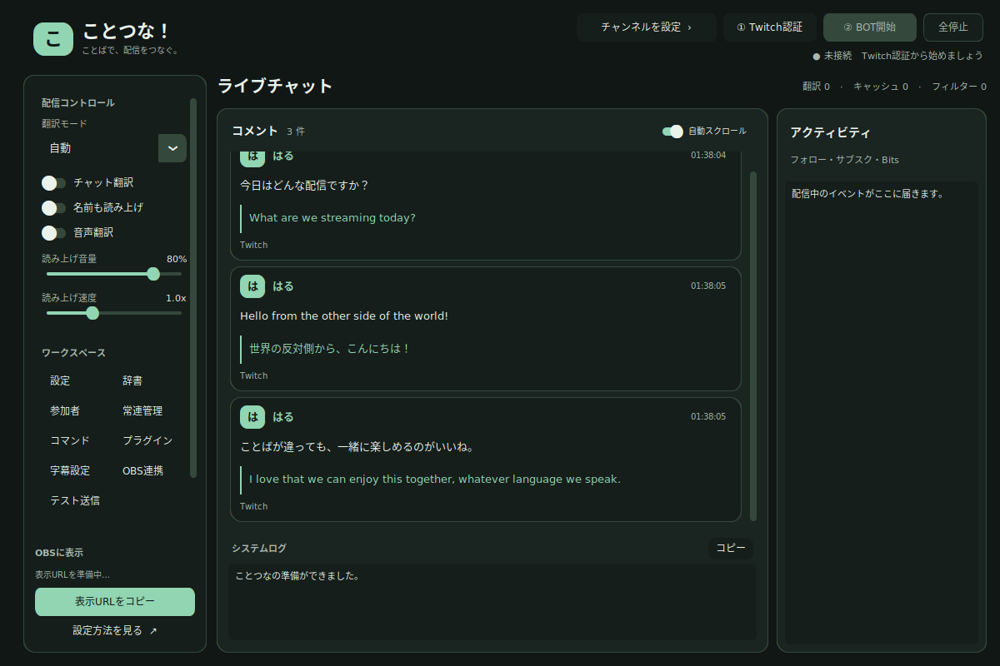

# ことつな！ - Twitch翻訳BOT

[](https://github.com/yukihina1587/kototsuna-bot/actions/workflows/test.yml)

Twitchのチャットメッセージをリアルタイムで翻訳するBOTです。ローカル翻訳エンジンと、VOICEVOXによる読み上げ機能を搭載しています。

## 主な機能

### チャット翻訳
- 日本語⇔英語の双方向自動翻訳（ローカル翻訳）
- 翻訳モード選択（自動 / 英→日 / 日→英）
- 翻訳のオン/オフ切り替え
- 原文＋翻訳をOBSの配信映像に表示。Twitchチャットへの自動投稿は任意（初期状態はOFF）
- 翻訳フィルター（特定ワードをスキップ）
- カスタム辞書（翻訳前の置換）

### 音声機能
- **チャット読み上げ（TTS）**: VOICEVOXによる高品質な音声読み上げ
  - 複数のボイスから選択可能
  - VOICEVOX未起動時はpyttsx3にフォールバック
- **音声翻訳（マイク入力）**: マイクに向かって喋った内容を翻訳
  - ローカル音声認識（ReazonSpeech-k2-v2）

### Twitchイベント検知
- **フォロー通知**: EventSub WebSocketで検知
- **サブスク通知**: 新規サブスク、継続サブスク
- **ギフトサブ通知**: ギフトサブ、ミステリーギフト
- **Bits（チア）通知**: 金額とメッセージ表示
- **イベント効果音**: 各イベントに個別の効果音を設定可能（ボリューム調整付き）

### チャットHTML出力（OBS連携）
- **OBSブラウザソース対応**: チャットログをHTMLファイルとして出力し、OBSのブラウザソースで直接読み込み可能
- **サードパーティエモート**: BTTV / FFZ / 7TV のエモートを画像として表示
- **自動更新**: HTMLファイルは自動的に更新され、OBS側でリアルタイム反映
- **簡易プレビュー**: アプリ内でテキストベースの簡易プレビューを表示

### その他の機能
- **オーバーレイサーバー**: OBS等で使用可能な翻訳オーバーレイ
- **参加者追跡**: キーワード検知で参加者を自動登録
- **チャットコマンド**: `!help`, `!translate`等のビルトインコマンド + カスタムコマンド
- **読み上げ辞書**: 漢字の読み間違いを修正
- **UIテーマ**: 4種類のテーマから選択可能
- **ログレベル切り替え**: DEBUG/INFO/WARNING/ERRORの動的切り替え
- **API安定性**: ネットワークエラー時の自動リトライ（指数バックオフ）
- **パフォーマンス最適化**: 翻訳バッチ処理、GUI差分更新、メモリ自動制限
- **自動アップデート**: GitHub Releasesからの自動更新チェック
- **軽量な配布**: 不要なブラウザエンジンを排除し、EXEサイズを大幅削減

## 必要なもの

- 配布版: Windows 10/11（WebView2 Runtimeは未導入時にセットアップが導入）
- ソース実行: Python 3.12以上
- Twitchアカウント
- マイク（音声翻訳機能を使用する場合）
- VOICEVOX Engine（高品質な読み上げを使用する場合、オプション）

## セットアップ手順

### 1. ライブラリのインストール

```bash
pip install -r requirements.txt
```

### 2. Twitchアプリケーションの登録

1. [Twitch Developers](https://dev.twitch.tv/console)にアクセス
2. 「アプリケーション」→「アプリケーションを登録」
3. 以下の情報を入力:
   - **名前**: 任意（例: `MyTranslateBot`）
   - **OAuthリダイレクトURL**: `http://localhost:8787/redirect.html`
   - **カテゴリ**: `チャットボット`
4. 作成後、**クライアントID**をメモ

### 3. VOICEVOX Engineのインストール（オプション）

1. [VOICEVOX公式サイト](https://voicevox.hiroshiba.jp/)からダウンロード
2. インストール後、起動（デフォルト: `http://localhost:50021`）

**フォールバック**: VOICEVOX未起動時は自動的にpyttsx3にフォールバックします。

### 4. 実行

```bash
python main.py
```

## 使い方

### 新しい配信画面（v1.10.0）

Windowsでは `python main.py` で新しい画面が1つ開きます。翻訳・音声処理も一緒に起動し、Twitch接続や音声・字幕・OBS設定を同じウィンドウで操作できます。閉じると処理も終了します。OBSの操作ドックは任意です。

Windows限定でpywebviewとWebView2 Runtimeを使います。「スタジオ」は右側に日常操作をまとめ、「フォーカス」はチャットを広げて操作を下部に配置します。選択は次回起動にも引き継ぎます。音声・字幕・OBS設定はチャットの隣で編集できます。[使い方・検証・移行範囲](docs/WEB-UI.md)。

従来画面はスタートメニューの「ことつな！ 従来画面」または `python main.py --legacy-ui` で利用できます。辞書・参加者・独自コマンド・プラグインなどの専用管理にはこちらを使用します。

### 初回起動時

1. **Twitch Client ID**を設定パネルに入力
2. **トークン認証**ボタンをクリック → ブラウザでTwitch認証
3. **チャンネル名**を入力（または認証アカウントと同じを選択）
4. **BOT起動**ボタンをクリック

### 画面構成（従来画面）



ヘッダーにチャンネル設定・Twitch認証・BOT開始／停止をまとめ、中央にコメント、右にアクティビティ、下にシステムログを表示します。原文と翻訳を並べて読め、長文は画面幅に合わせて折り返します。

設定や辞書は右側のパネルで開きます。ログの幅と分割位置を保ち、閉じて開き直しても入力途中の内容とスクロール位置を維持します。「閉じる ×」・同じパネルの再選択・Escで閉じられます。

配色はフォレストを基調とするダークテーマと、ミニマル・グラデーション・サイバーパンクに対応。既存のカスタムテーマも利用でき、配色は選択するとすぐに画面全体へ反映され、接続状態や入力途中の内容も保持します。[デザインと検証の詳細](docs/UI-REDESIGN.md)。

### 左サイドバー

- **配信コントロール**: 翻訳モード、チャット翻訳・名前読み上げ・音声翻訳、読み上げ音量・速度
- **ワークスペース**: 設定・辞書・参加者・常連管理・コマンド・プラグイン・字幕・OBS・テスト送信
- **OBSに表示**: 表示URLのコピー。小さいウィンドウでもこの操作は下部に固定表示

コメントの「自動スクロール」をOFFにすると、過去のコメントを読みながら新しいコメントを受信できます。

### 右パネル（設定）

| タブ | 設定項目 |
|-----------|---------|
| 接続 | Twitch認証、チャンネル、任意の翻訳投稿、投稿時の言語2 |
| 音声 | マイク、読み上げエンジン、VOICEVOXパス・自動起動、ボイス選択 |
| 表示 | UIテーマ、ログレベル、コメント外観・表示順 |
| 効果音 | Bits/サブスク/ギフトサブ/フォローの効果音と音量 |
| 管理 | ウェルカム、アーカイブ、アップデート、プライバシー |

### 右パネル（辞書）

| 辞書 | 説明 |
|-----|------|
| 読み上げ辞書 | 漢字の読み間違いを修正（例: 草→くさ） |
| 翻訳フィルター | 翻訳をスキップするワード |
| 翻訳カスタム辞書 | 翻訳前に置換するワード |

### 右パネル（コマンド）

| 機能 | 説明 |
|-----|------|
| コマンドON/OFF | チャットコマンド機能の有効/無効 |
| カスタムコマンド追加 | コマンド名・応答・権限・クールダウンを設定 |
| コマンドリスト | 登録済みコマンドの確認・削除 |

### チャットコマンド

| コマンド | 権限 | 説明 |
|---------|------|------|
| `!help` | 全員 | コマンド一覧を表示 |
| `!translate <テキスト>` | 全員 | テキストを翻訳 |
| `!lang` | 全員 | 現在の翻訳モードを表示 |
| `!tts on/off` | モデレーター | TTS読み上げの切替 |
| `!voice` | モデレーター | VOICEVOXボイス一覧 |

カスタムコマンドはGUIの「コマンド」パネルから追加できます。応答テンプレートでは `{user}`, `{channel}`, `{time}`, `{date}` の変数が使用可能です。

## オーバーレイ機能

### 配信映像に原文＋翻訳を表示する

1. ことつな！でTwitchへ接続し、「チャット翻訳」を有効にする（起動時は毎回OFF）。
2. 「Twitchチャットにも投稿する」はOFFのままにする。
3. サイドバー下部の「OBSに表示」→「表示URLをコピー」を押す。
4. OBSに「ブラウザ」ソースを追加し、コピーしたURLを設定する。

コメントの原文と翻訳が配信映像に表示されます。Twitchへの翻訳再投稿や、OBS WebSocketの接続設定は不要です。コメントの受信には引き続きTwitch接続が必要です。

- **チャット表示URL**: `http://localhost:8080/chat`（ポートは自動検索するため、アプリのURLコピーを使用）
- **チャットデータ**: `GET /api/chat`

Twitchのチャット欄にも翻訳を残したい場合は、「Twitchチャットにも投稿する」をONにします。「投稿時の言語2」は追加投稿用で、配信映像に表示する翻訳は「翻訳モード」で選びます。投稿に失敗しても表示・読み上げは継続します。

既存の設定に投稿の指定がない場合も、自動投稿はOFFになります。この設定は通常コメントの翻訳再投稿だけを対象にし、コマンド返信・歓迎メッセージ・音声翻訳などの投稿設定は変更しません。

### 翻訳テキストのオーバーレイ

- **URL**: `http://localhost:8080/overlay.html`（ポートは自動検索）
- **API**:
  - `GET /api/current` - 現在の翻訳テキスト
  - `GET /api/history` - 翻訳履歴（最新50件）

## 設定ファイル

設定は `config.json` に自動保存されます。

<details>
<summary>主な設定キー</summary>

| キー | 説明 | デフォルト |
|-----|------|-----------|
| `twitch_client_id` | Twitch Client ID | "" |
| `channel_name` | チャンネル名 | "" |
| `translate_mode` | 翻訳モード | "自動" |
| `chat_translation_post_to_twitch` | 通常コメントの翻訳をTwitchにも自動投稿 | false |
| `commands_enabled` | コマンド機能の有効/無効 | true |
| `voicevox_speaker_id` | ボイスID | 14 |
| `voicevox_auto_start` | VOICEVOX自動起動 | true |
| `ui_theme` | UIテーマ | "default" |
| `log_level` | ログレベル | "INFO" |
| `bits_sound_path` | Bits効果音パス | "" |
| `bits_sound_volume` | Bits効果音音量 | 80 |
| `chat_log_history_limit` | ログ履歴の上限 | 1000 |
| `participant_limit` | 参加者数の上限 | 1000 |
| `auto_restart_enabled` | メモリ超過時の自動再起動 | false |
| `auto_restart_threshold_mb` | 自動再起動の閾値(MB) | 1000 |
| `auto_update_check` | 起動時のアップデート確認 | true |

</details>

## ログファイル

ログは `dist/logs/bot_YYYY-MM-DD.log` に出力されます。
- 日付ごとにローテーション
- 7日間保持

## トラブルシューティング

### VOICEVOX に接続できない

1. VOICEVOX Engineが起動していることを確認
2. 設定パネルで「接続テスト」を実行
3. ファイアウォールでポート50021が許可されていることを確認

### 翻訳されない

1. ローカル翻訳モデルが配置されていることを確認
2. 「チャット翻訳」トグルがオンになっていることを確認
3. 翻訳フィルターに該当していないことを確認

### 音声認識が動作しない

1. マイクが正しく選択されていることを確認
2. マイクのアクセス権限を確認
3. ローカル音声認識モデルが配置されていることを確認

### メモリ使用量が増え続ける

1. `config.json`の`auto_restart_enabled`を`true`に設定すると閾値超過時に自動再起動
2. ログ履歴上限は`chat_log_history_limit`で調整可能（デフォルト1000）
3. `scripts/profile_app.py cpu`でCPUプロファイリングが可能

## プラグイン（わんコメ互換）

ことつなはわんコメ互換の JavaScript プラグイン (`plugin.js`) に対応しています。  
Node.js がインストールされていれば、わんコメ用に作られたプラグインをそのまま利用できます。

### プラグインの配置

```
%APPDATA%\Kototsuna\plugins\{plugin-name}\plugin.js
```

フォルダを作成して `plugin.js` を配置するだけで、BOT 起動時に自動的に読み込まれます。

### 対応フック

| フック | 説明 |
|--------|------|
| `init({ dir, store }, initialData)` | 起動時に1回呼ばれる |
| `filterComment(comment, service, userData)` | コメントごとに呼ばれる。`false` を返すとブロック、変更したオブジェクトを返すと変換 |
| `subscribe(type, data)` | コメントイベント通知 (`type='comments'`) |
| `destroy()` | 停止時に呼ばれる |

### サンプル plugin.js

```javascript
const plugin = {
  name: 'My Plugin',
  uid: 'com.example.myplugin',
  version: '1.0.0',
  author: 'YourName',
  permissions: ['comments'],

  init({ dir, store }, initialData) {},
  destroy() {},

  filterComment(comment, service, userData) {
    // NGワードをブロック
    if (comment.data.comment.includes('NG')) return false
    return comment
  },

  subscribe(type, ...args) {
    if (type === 'comments') {
      const { comments } = args[0]
      // 全コメントを受信
    }
  },
}
module.exports = plugin
```

### 注意

- Node.js が必要です（[nodejs.org](https://nodejs.org/)）
- `store` は `%APPDATA%\Kototsuna\plugin-store\{uid}.json` に永続化されます

## プライバシー / クラッシュレポート

不具合修正のため、ことつな！は**任意で**クラッシュレポートを送信できます（オプトイン制、デフォルトは送信しない）。

- 何が送信され、何が送信されないかは [docs/PRIVACY.md](docs/PRIVACY.md) を参照してください
- 設定パネルの「プライバシー」セクションでいつでも有効化／無効化できます
- チャンネル名・コメント本文・トークン等の個人情報は送信されません

## ライセンス

MIT License

## 貢献

Issues や Pull Requests を歓迎します。
