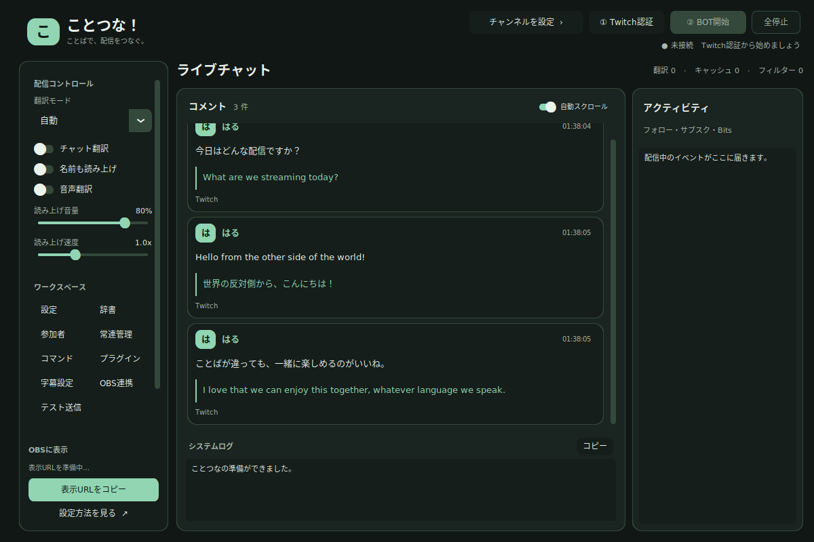
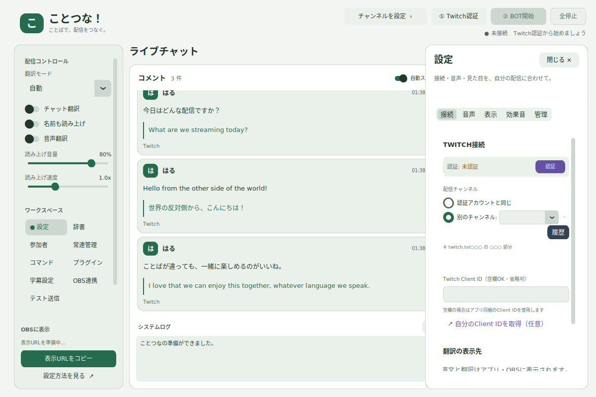

# デスクトップUI刷新 — 2026-10-31

配信中の接続・翻訳・読み上げ操作を保ち、画面全体の配色と情報配置を整理しました。新しいライブラリや外部サービスは追加していません。

## 画面





画像は実際のCustomTkinterウィジェットを使った確認画面です。表示しているコメントはサンプルで、Twitch・OBS・音声エンジンには接続していません。

## 操作と互換性

- 接続操作は従来と同じ「認証 → BOT開始」の順序。ヘッダーのチャンネル表示から設定を開けます。
- 左側に翻訳・音声操作、2列のパネルナビゲーション、下部にOBS表示URLのコピーを配置。小さい画面では左側の上部がスクロールします。
- コメント・システムログ・アクティビティの分割はドラッグで調整できます。設定パネルはログの手前に重ねて表示し、背後の分割位置は変えません。
- 設定は5タブに分類。パネルを閉じてもウィジェットを保持し、再表示時は参加者や常連などのリストを更新します。
- コメントはユーザー名・時刻・原文・翻訳・プラットフォームを表示。読めないユーザー色はテーマ色へ置き換え、長文とエモートの表示幅に対応します。
- 自動スクロールをOFFにすると閲覧位置を保持。再度ONにすると表示順に応じた最新側へ移動します。表示上限120件と既存の順序設定は維持します。
- 既存のテーマキー、設定ファイル、投稿・読み上げ・翻訳処理を維持します。UIのテーマ変更は次回起動時に一括適用します。
- システムログの既定配色はテーマに追従し、ユーザーが変更した色・フォントは引き続き優先します。
- チャット翻訳は従来どおり起動時OFF。任意のTwitch投稿設定を現在の設定パネルへ接続し、投稿OFF時は2言語目の選択を無効表示にします。

## 実装

| ファイル | 役割 |
|---|---|
| `src/gui_layout.py` | ヘッダー、サイドバー、ログ領域、パネルの表示と保持 |
| `src/gui_comments.py` | コメントカード、幅に応じた折り返し、エモート表示 |
| `src/gui_theme.py` | 4つの配色、コントラスト判定、CustomTkinter共通スタイル |
| `src/gui.py` | 既存のアプリ状態、接続・保存のコールバック、各設定内容 |
| `src/config.py` | GUIを初期化せず組み込み・カスタムテーマを検証 |

カスタムテーマのJSON形式は変更していません。表示層の分離により、配色の検証で音声やGUIを初期化する循環参照も解消しました。

## 検証

通常の検証（プロジェクトの既存venvを使用）:

```bash
PYTHONDONTWRITEBYTECODE=1 venv/bin/python -m pytest tests/test_gui_theme.py tests/test_config.py tests/test_theme_loader.py tests/test_theme_editor.py tests/test_gui_voice.py tests/test_chat_translation_output.py tests/test_bot.py -q
PYTHONDONTWRITEBYTECODE=1 venv/bin/python -m pytest tests/ -q --ignore=tests/test_tts.py --ignore=tests/test_bot.py
```

実画面の検証はディスプレイが使える環境で明示的に実行します。接続、設定保存、モデル、音声、アップデート確認、サーバーはテスト内で差し替えています。

```bash
KOTOTSUNA_GUI_TESTS=1 PYTHONDONTWRITEBYTECODE=1 venv/bin/python -m pytest tests/test_gui_workspace.py -q
```

`KOTOTSUNA_SCREENSHOT_DIR` を指定するとサンプル画面を保存します。Linux/WSLgではテスト用ウィンドウだけを直接撮影し、デスクトップ全体は取得しません。

4テーマ、1000×700・1200×800、全9パネルの開閉、入力保持、翻訳投稿スイッチ、長文・エモート・並び順・120件制限と同じ処理、スクロール停止、接続ボタンの既存コールバックを検証対象としています。

最終結果:

| 検証 | 結果 |
|---|---|
| 変更範囲とBOTの関連テスト | 126 passed |
| 実ウィジェット・4テーマのGUIテスト | 36 passed |
| CIと同じ全体対象 | 427 passed / 2 failed / 37 skipped |
| 変更したPythonの構文確認・差分の空白確認 | 成功 |

全体実行のskipには、別途実行したGUIテスト36件を含みます。

全体テストには、この作業前の記録にもある環境依存の失敗が2件残ります。

- `test_list_voices_sync_returns_curated_jp_voices`: 検証用venvに既存依存の`edge-tts`がなく、話者一覧が空。
- `test_process_result_without_api_key`: テストは原文の返却を期待するが、この環境にはローカル翻訳モデルがあり、実際の翻訳文が返る。

## Windowsビルド

2026-10-31、Windows用Python 3.13.11を使い、`build/windows-venv` に独立したビルド環境を作成しました。`requirements.txt` の指定バージョンとPyInstaller 6.22.3を使用しています。既存の `.venv-win` は変更していません。

Windows側からのビルドコマンド:

```powershell
build\windows-venv\Scripts\python.exe -X utf8 -m PyInstaller --noconfirm --workpath build/windows-redesign --distpath dist Kototsuna.spec
```

生成物は `dist/Kototsuna/Kototsuna.exe`（Windows x64、16,232,179 bytes）。翻訳・音声認識モデルなどを含むフォルダー全体は約1,019 MiBです。起動・移動時には同じフォルダー内の `_internal` が必要です。

PE形式、必要なDLL、モデル、Tcl/Tk ZIPの整合性、EXE内の新UIモジュール、同梱ソースと作業ソースのハッシュ一致を検証しました。`pip check` も成功しています。検証結果とSHA-256は `dist/Kototsuna/BUILD-INFO.json` に保存しています。

Windowsのビルド環境でも関連テスト126件、4テーマのGUIテスト36件が成功しました。GUIテストは実際のアプリと同じく単一のTkインタープリターを使い、各ケースでウィジェットとタイマーを片付けます。これによりWindowsでTkを繰り返し初期化した際のTclスクリプト読み込みエラーを回避しています。

EXEのSHA-256:

```text
87d6712196307d128e79137ffded37e1837c47150ad02a71f9c9f47e71b776d3
```

既存インストール先への配置、Twitch実接続・OBS配信・音声デバイスでの検証は行っていません。

## 自動更新用リリース

正式版 `v1.9.0` では、`src/__init__.py` と `pyproject.toml` のバージョンを揃え、既存のGitHub Actionsから `Kototsuna_Setup.exe` を作成します。通常の更新確認は正式版だけを取得するため、プレリリースにはしません。

タグをpushすると、CIと同じ対象のテストが成功した後にWindowsでモデル同梱版をビルドし、Inno Setupでインストーラーを作成します。生成物は一度ドラフトリリースに保存します。ファイルとSHA-256を検証した後、ドラフトを公開してLatestに指定します。今後も公開前にこの確認が必要です。

リリース本文のハッシュは、既存アップデーターが読み取れる `SHA256: <64桁のハッシュ>` 形式で記載します。アプリは `Kototsuna_Setup.exe` を取得して検証し、既存のインストール先を更新します。

今回の配布対象にはUI刷新と翻訳投稿の任意設定を含め、別途開発中のHeadless TTS Serviceは含めません。元の作業ディレクトリの未コミット変更は保持し、`release/1.9.0` ブランチで配布内容を管理します。

公開用ソースを独立したPython 3.12環境と `requirements-ci.txt` で検証した結果は、関連テスト105 passed / 4 skipped、CIと同じ全体対象416 passed / 44 skippedでした。スキップにはGUIテストとGUI・音声依存が必要なテストを含み、同一の表示実装は前述のWindows環境で別途検証済みです。
